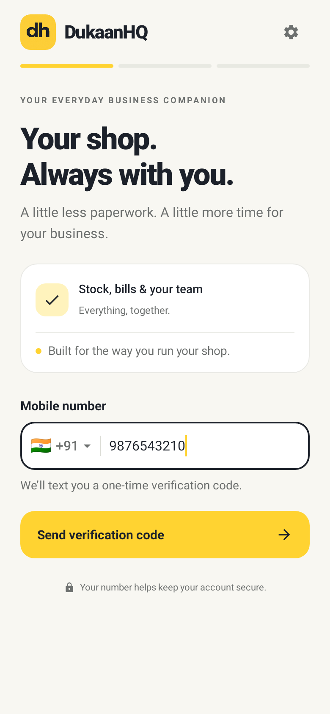
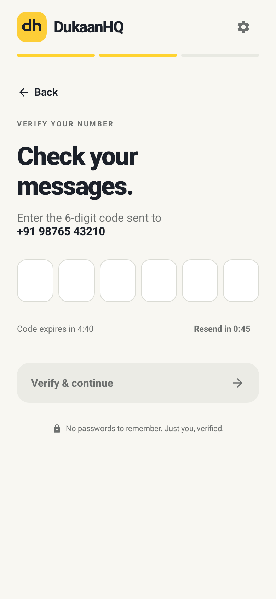
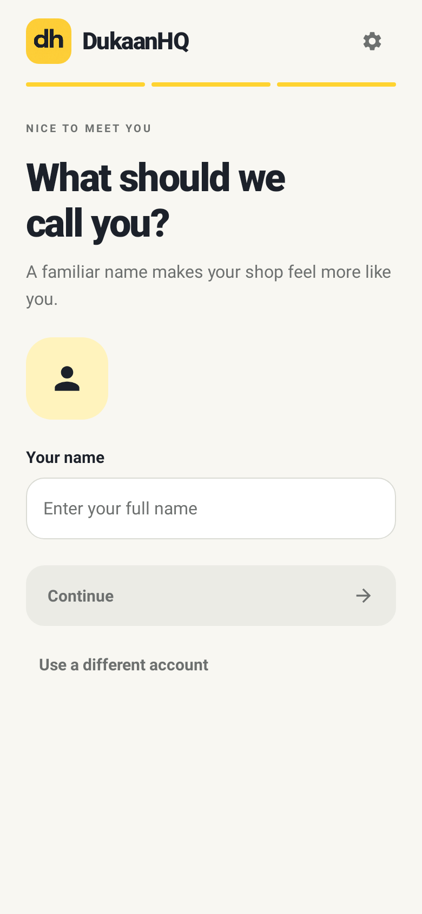
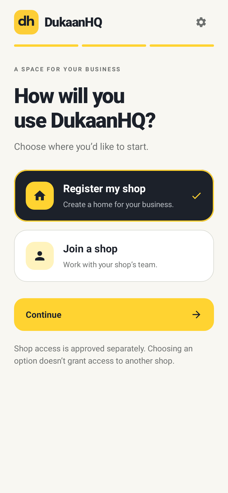
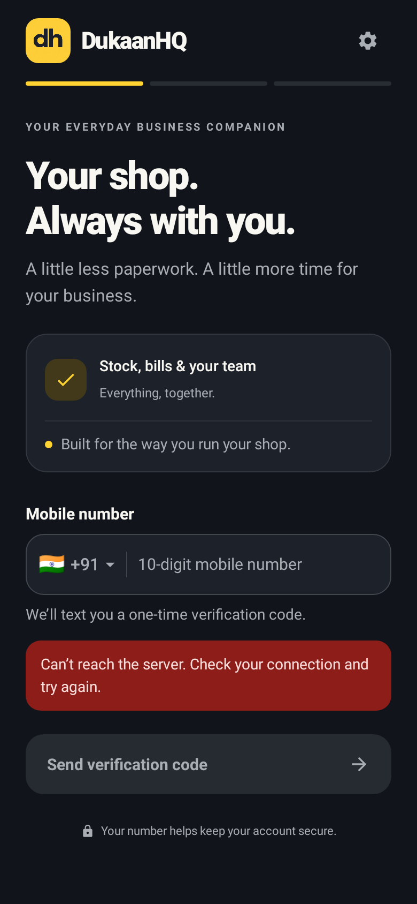
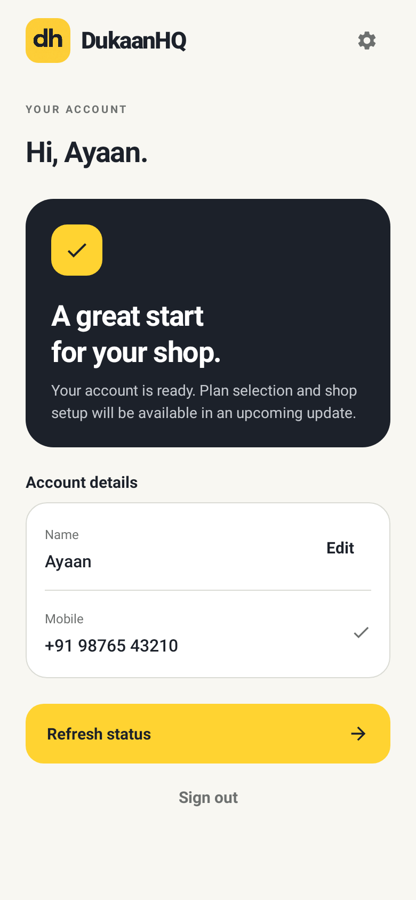

# Android authentication milestone

Built before Phase 3 at the user's request, so Phase 2 can be tested on Android.
Setup: [Twilio/Supabase/backend env](SMS_SETUP.md). Build/install:
[Android README](../android/README.md).

The app uses Kotlin/Compose, the existing unchanged logo and its yellow/charcoal palette.
Short fade/slide transitions, input feedback and loading states use Compose animation
and the system animation duration scale. Both light and dark themes are supported.

Implemented: country search/calling-code selection, phone validation, SMS OTP input/paste,
resend/expiry timing, name completion, owner/staff intent, server-derived access/next-step
states, name editing, session restoration/refresh/logout and authenticated phone-link APIs.
Debug builds can select/test a backend URL without carrying credentials across servers.

Google OAuth entry, native CAPTCHA, plan selection, shop onboarding and actual staff
invitation acceptance remain pending. The app does not fake those operations or display
invented shop totals. There is no demo-login mode or OTP bypass in the installed app.

## Verification

- `:app:testDebugUnitTest`: **20 tests passed**, zero failures/skips.
  Ten HTTP/session tests cover wire contracts, coordinated refresh, transient/rejected
  credentials, local/remote logout failures, endpoint changes and safe error mapping.
  Two phone-library tests cover India/default lengths and international regions.
  Eight native Compose tests cover forms, paste/resend, role choice, dark/error states,
  account status, country selection and 320 dp screens with larger text.
- `:app:assembleDebug`: successful. Installable APK at
  `new/android/app/build/outputs/apk/debug/app-debug.apk`, app ID `com.dukaanhq.app.debug`,
  launcher name **DukaanHQ Dev**. Debug HTTP is allowed; release requires an HTTPS URL.
- `:app:lintDebug`: successful, no errors. Version-update suggestions for the pinned
  SDK 35 dependency baseline and an explicit checked preference commit are documented
  rather than reported as a tested dependency/SDK upgrade.
- Kotlin source formatted with ktfmt 0.64. Official Gradle wrapper distribution checksum
  is pinned. GitHub Actions checks/builds the app; remote CI has not been run in this work.
- UI renders below were produced from real Compose layouts with Robolectric native
  graphics and visually inspected. They are fixture renders, not phone screenshots.
- Original logo and packaged source asset have identical SHA-256 hashes.

No real SMS, production migration or provider-setting update was performed. The backend
local `.env` was prepared only if absent, with existing public Supabase values and a new
rate-limit secret. It remains ignored and auth stays disabled until setup is completed.
The app has no Twilio/Supabase credential fields; only a Nest API base URL is required.

Remaining acceptance: install on a real device, finish matching database/SMS settings,
verify delivery, process restart/Keystore behavior and foreground/keyboard behavior on
that device. The test runner cannot establish hardware-backed key security or real SMS
delivery. Comparative business performance baselines from Phase 1 remain open.

## Screens

[Small screen/larger text render](android-previews/07-small-screen.png).
